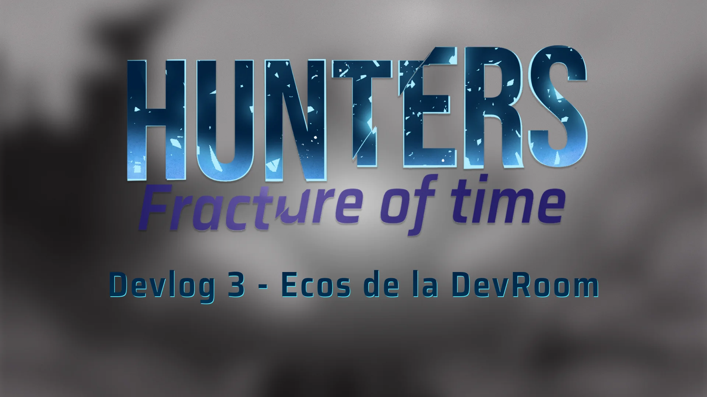
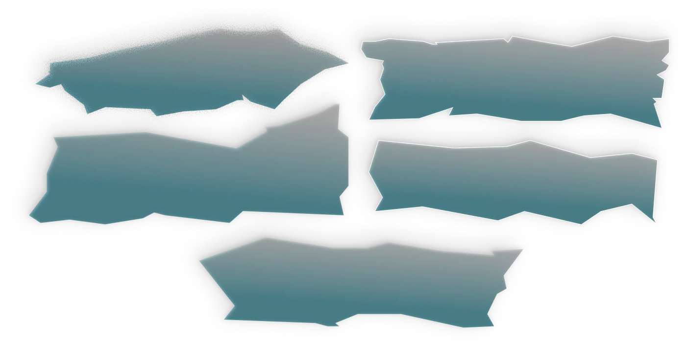
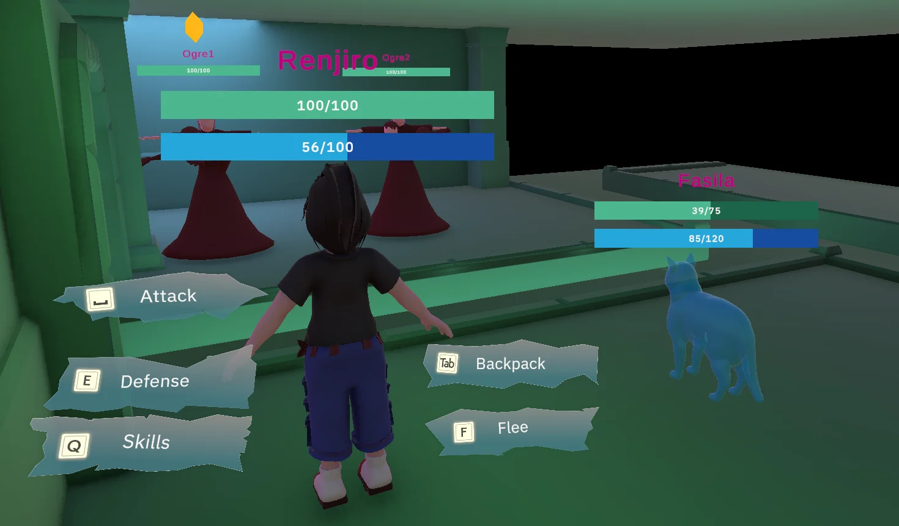
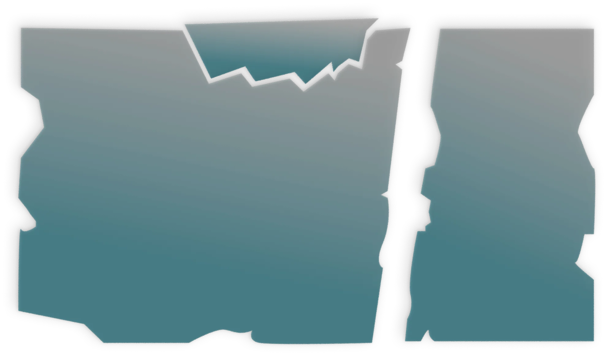
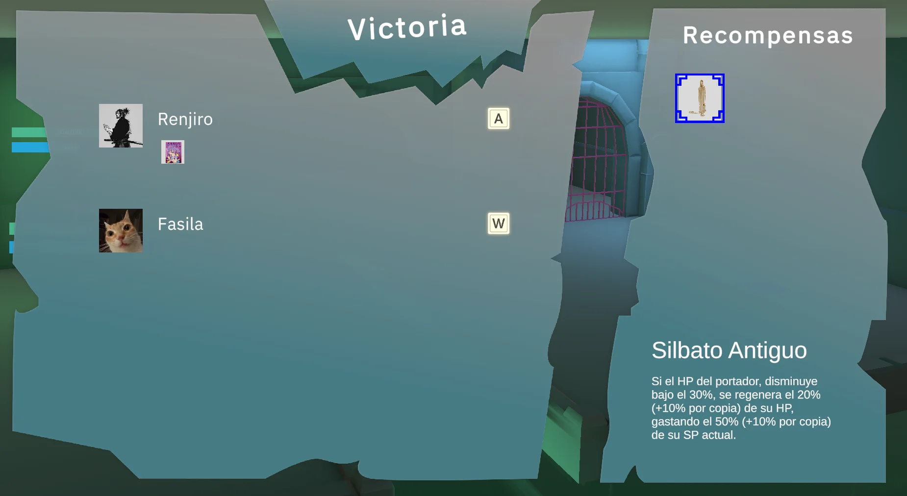

Buenas, aquí Ame.

Quiero hablarles de el sonido del juego, ya que hasta ahora ha sido un paisaje bastante mudo.
Los efectos de sonido de Hunters: Fractura del Tiempo fueron creados con varios sonidos de varias bibliotecas de sonido y foley de mi parte editados juntos para crear algo nuevo y convincente con el fin de darle feedback al jugador. El proceso de diseño fue interesante ya que involucró encontrar una identidad sonora para cada personaje, cosa que conversé extensamente con Marchel, lo que llevó a las siguientes identidades para los personajes:

  

    
Identidad sonora

    
Renjiro

    

      CálidoAbrasanteLíquido
    

  

  

    
Identidad sonora

    
Fasila

    

      CristalinoMelódicoFrío
    

  

El proceso de renjiro comenzó con sonidos de agua, chapuzones, rios fluyendo, etc e impactos genericos de varias librerías para darle extra, bueno, impacto, a los sonidos. Terminé utilizando muchos sonidos grabados bajo el agua ya que estos sonaban como liquido moviendose de tal manera que ese liquido podía ser un poco mas espeso (como la brea de renjiro). Esto en combinación con impactos y fuego crearon un ambiente sonoro bastante convincente. 

:::audio
[Renjiro — Ataque Básico](../assets/devlogs/hunters-fracture/sound-and-identities/renjiro-attack.mp3)
[Renjiro — Técnica 2 - Envolver](../assets/devlogs/hunters-fracture/sound-and-identities/renjiro-skill1.mp3)
[Renjiro — Técnica 1 - Miasma](../assets/devlogs/hunters-fracture/sound-and-identities/renjiro-skill2.mp3)
[Renjiro — Técnica Definitiva Marea Negra](../assets/devlogs/hunters-fracture/sound-and-identities/renjiro-ultimate.mp3)
:::

Para Fasila el proceso fue muy distinto ya que no encontré un sonido de cristal satisfactorio para sus efectos, entonces cree uno utilizando uns copa de vino.

Grabé varias tomas de la copa, golpeandola con dedos, tenedores, pinzas, el palo de un tazón resonante, etc. Al final de todo esto terminé con sonidos apropiadamente cristalinos e, importantemente, afinados para el moveset de Fasila, melodía escalofriante fue por bastante el sonido que mas me costó crear debido a mi inexperiencia musical, pero quedó bastante escalofriante. 

:::audio
[Fasila — Ataque Básico](../assets/devlogs/hunters-fracture/sound-and-identities/fasila-attack.mp3)
[Fasila — Técnica 1 Resonancia](../assets/devlogs/hunters-fracture/sound-and-identities/fasila-skill1.mp3)
[Fasila — Técnica 2 Disrupción](../assets/devlogs/hunters-fracture/sound-and-identities/fasila-skill2.mp3)
[Fasila — Técnica Definitiva Melodía Escalofriante](../assets/devlogs/hunters-fracture/sound-and-identities/fasila-ultimate.mp3)
:::

Lo otro en lo que estuve empeñandome fue el diseño de UI, tanto visual como funcional. Comenzamos desde una filosofía de crear UI intuitivo y no muy complicado, en el fondo que el UI sea pick up and play y no muy intrusivo al momento de querer hacer cosas. 

En cuanto a tematica visual decidimos ir por una tematica de vidrio roto, el primer asset creado con eso en mente fueron los botones de combate.

Aunque al hablar con otros artistas me di cuenta que el vidrio no se rompe así, entonces estuve refinando lo visual hasta llegar al menú de recompensas que es lo mejor que he hecho en cuanto la tematica visual de vidrio roto. 

Para finalizar este devlog, queremos compartirles un avance del tema de combate, compuesto por uno de los músicos, Joshua Quiroz.

:::audio
[Combat OST (WIP) by Joshua Quiroz](../assets/devlogs/hunters-fracture/sound-and-identities/combat-ost.mp3)
:::

Gracias por acompañarnos durante este devlog, en el próximo hablaremos del combate y la demo técnica, que tengan una linda tarde o/